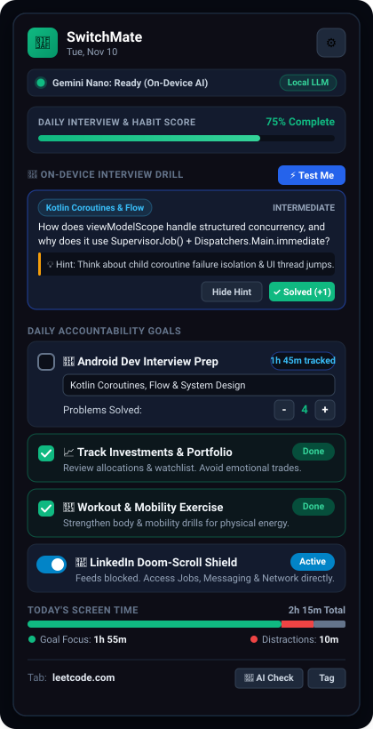
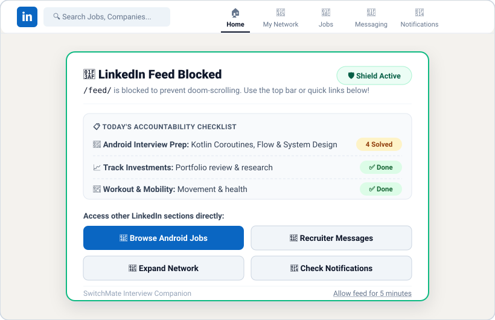
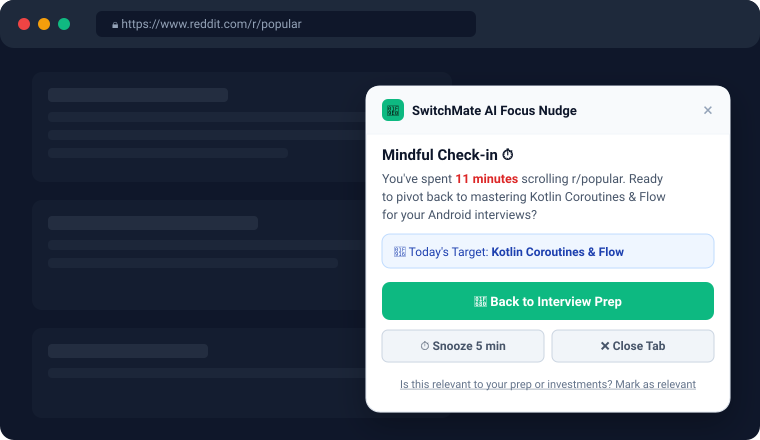
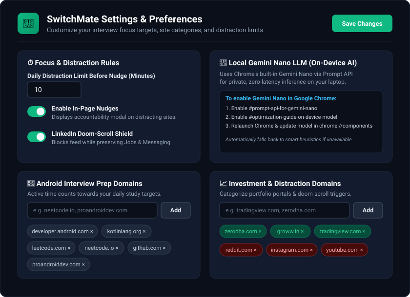

# 🎯 SwitchMate — Interview & Focus Companion (Chrome Extension)

[](#)
[](#-local-gemini-nano-chrome-built-in-ai)
[](#)

A Chrome extension built to accelerate and protect your interview preparation days by keeping you accountable to your **4 daily goals**, tracking active site usage, nudging you with **on-device Gemini Nano AI** when off-track, and eliminating **LinkedIn doom-scrolling** while keeping high-intent features (*Jobs, Messaging, Network, Notifications*) intact.

---

## 📸 Screenshots

### 1. Popup Dashboard & On-Device Interview Drill
Track your daily habit score, drill Android interview questions generated locally by **Gemini Nano**, log DSA/LeetCode problems solved, and inspect real-time screen time breakdowns.

<p align="center">
  
</p>

### 2. LinkedIn Doom-Scroll Shield
Automatically blocks the infinite LinkedIn newsfeed (`/feed/`) while keeping the top navigation bar and direct links to **Jobs**, **Recruiter Messages**, **My Network**, and **Notifications** one click away.

<p align="center">
  
</p>

### 3. Context-Aware AI Focus Nudge
When you exceed your daily distraction limit on social or entertainment sites, SwitchMate displays a gentle floating check-in tailored to your current study topic.

<p align="center">
  
</p>

### 4. Customizable Settings & Domain Categories
Configure your distraction threshold, toggle shields, and manage domain lists for **Android Interview Prep**, **Investments & Portfolio**, and **Distractions**.

<p align="center">
  
</p>

---

## 🎯 Tailored to Your 4 Daily Goals

1. **🏃 Workout & Mobility Exercise**
   - Daily accountability checkbox in the popup & LinkedIn shield checklist.
   - Physical readiness tracker so you stay energized for coding and interviews.

2. **📈 Tracking Investments & Portfolio**
   - Whitelisted financial platforms (`zerodha.com`, `groww.in`, `tradingview.com`, etc.) so portfolio reviews are recognized as productive.
   - Checklist item to mark review done and prevent impulsive, distracted screen time.

3. **🤖 Android Developer Interview Prep**
   - Active study time tracking across Android engineering resources (`developer.android.com`, `kotlinlang.org`, `leetcode.com`, `neetcode.io`, `github.com`, `proandroiddev.com`, etc.).
   - Interactive **DSA / LeetCode problem counter** (`+` / `-`).
   - Daily **Focus Topic input** (e.g. *Kotlin Coroutines & Flow*, *Jetpack Compose Recomposition*, *System Design*).
   - **"Back to Interview Prep"** quick jump action from any distracting site.

4. **💼 Mindful LinkedIn (No Doom-Scrolling)**
   - **Shields the endless feed**: Automatically intercepts `/feed/`, pauses background videos, locks feed scrolling, and replaces the feed with an accountability dashboard.
   - **Full access to high-intent tools**: Direct quick-access buttons to **Browse Android Jobs** (`/jobs/`), **Recruiter Messages** (`/messaging/`), **Expand Network** (`/mynetwork/`), and **Notifications** (`/notifications/`).
   - Optional **5-minute temporary unlock pass** if you need to view a specific post.

---

## 🧠 Local Gemini Nano (Chrome Built-in AI)

SwitchMate integrates Chrome's on-device **Gemini Nano LLM** via the Chrome Prompt API (`window.ai` / `ai.languageModel`):
- **100% Local & Private**: No cloud API keys or external server requests required. All reasoning runs on your local machine with zero latency.
- **Smart Intent & Content Classification**: When visiting ambiguous pages (e.g. YouTube, Reddit, Medium), Gemini Nano analyzes the page title, headings, and description to distinguish between Android engineering tutorials / investment research and entertainment distractions.
- **Context-Aware Focus Nudges**: Rather than generic alerts, Gemini Nano creates personalized prompts comparing what you are currently viewing with your topic of the day.
- **On-Device Interview Drill**: Click **⚡ Test Me** in the popup to have Gemini Nano generate an Android interview question tailored to your topic of the day, complete with progressive hints and solved tracking.

### How to Enable Gemini Nano in Google Chrome:
1. Open `chrome://flags/#prompt-api-for-gemini-nano` in Chrome and choose **Enabled**.
2. Open `chrome://flags/#optimization-guide-on-device-model` and choose **Enabled BypassPerfRequirement**.
3. Relaunch Chrome.
4. Go to `chrome://components/`, find **Optimization Guide On Device Model**, and click **Check for update** to trigger model weights download.
*(Note: If Gemini Nano is not enabled, SwitchMate seamlessly falls back to smart local heuristics so tracking and protection never stop).*

---

## 🚀 How to Install & Load in Chrome

1. Clone or download this repository:
   ```bash
   git clone git@github-personal:balajiprabhu-github/SwitchMate.git
   ```
2. Open Google Chrome and navigate to `chrome://extensions/`.
3. Turn on the **Developer mode** toggle in the top-right corner.
4. Click **Load unpacked** in the top-left.
5. Select the `SwitchMate` directory.
6. Pin **SwitchMate - Interview & Focus Companion** 🧩 to your Chrome toolbar for instant access!

---

## 📂 Project Structure

```text
SwitchMate/
├── manifest.json               # Chrome Extension Manifest V3 configuration
├── background.js               # Service worker for active-time tracking, alarms & state
├── content/
│   ├── linkedin-shield.js      # Content script blocking LinkedIn feed & injecting shield UI
│   ├── linkedin-shield.css     # Styles for LinkedIn feed shield & dark-mode support
│   ├── nudge.js                # Content script for AI page classification & focus nudges
│   └── nudge.css               # Styles for floating in-page nudge modal
├── popup/
│   ├── popup.html              # Extension popup dashboard UI
│   ├── popup.css               # Dark-themed popup styling
│   └── popup.js                # Popup controller, goal checklist & interview drill logic
├── options/
│   ├── options.html            # Extension settings & domain categorization UI
│   ├── options.css             # Settings page styling
│   └── options.js              # Settings persistence & defaults restoration
├── utils/
│   └── gemini-nano.js          # On-device Gemini Nano Prompt API wrapper & heuristic fallbacks
├── icons/                      # Extension icons (16x16, 48x48, 128x128)
└── screenshots/                # UI screenshots used in documentation
```
